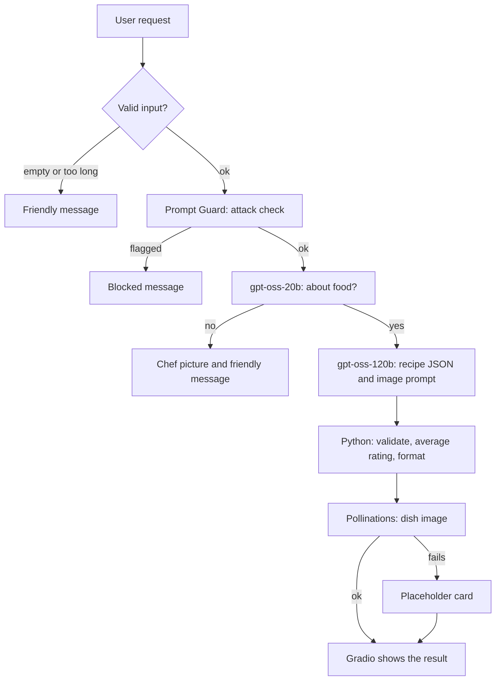

# 🍳 Chef Aria

**Chef Aria is a cooking recommendation chatbot, a generative-AI app that turns a craving into a complete cooking suggestion.** Describe what you feel like eating and it returns a dish, why it fits, ingredients, preparation steps, a short history, example reviews with a star rating, and a generated picture of the dish.

[](https://colab.research.google.com/github/Mohamed-Hmaidi/Chef-Aria/blob/main/cooking_chatbot.ipynb)


## Demo
https://github.com/user-attachments/assets/4feb5c18-a074-4e3a-84fc-4b14cb55fef3


## Example

**Request:** `something light for dinner`

**Result:** a complete recipe card: the dish, a short "Why I picked it" explanation, a description, ingredients, preparation steps, the history of the dish, three example reviews with an average star rating, and a generated photo.

Results vary between runs. In one test at temperature 0.8, the same request returned a citrus quinoa salad, a lemon-herb quinoa bowl and grilled salmon with a cucumber-dill salad.

## What this project demonstrates

- **A multi-step LLM pipeline,** not a single prompt: a security model, a topic classifier, a 120B-parameter generator and an image model, chained together.
- **Prompt engineering:** persona, one-shot and few-shot examples, chain of thought, structured JSON output, and prompt chaining (one model writes the prompt for the image model).
- **Working within real limits:** free-tier rate limits are handled with token budgeting, retries, request spacing and fallbacks, so the app degrades gracefully instead of crashing.
- **Product thinking:** friendly messages for off-topic input, a waiting state, a locked button to prevent duplicate requests, and a drawn fallback picture.

## How it works



| Model | Service | Job |
|---|---|---|
| Llama Prompt Guard 2 (86M) | Groq | Security classifier: scores prompt-injection and jailbreak risk |
| gpt-oss-20b | Groq | Few-shot YES/NO check: is the request about food? |
| gpt-oss-120b | Groq | Writes the whole recipe as structured JSON, including the image prompt |
| Image model behind Pollinations | Pollinations.ai | Draws the dish picture |

More detail: [docs/architecture.md](docs/architecture.md) and [docs/prompt-engineering.md](docs/prompt-engineering.md).

## Tech stack

Python, Gradio (interface), Groq API (LLMs), Pollinations.ai (image generation), Pillow (placeholder and chef drawings), Google Colab.

## Quick start

1. Click the **Open in Colab** badge above.
2. Get a free Groq API key at <https://console.groq.com/keys>.
3. Choose **Runtime > Run all** and paste the key when asked. It goes into a hidden input box and is never saved in the notebook.
4. Open the public link that Gradio prints.

Prefer a local Jupyter? Run `pip install -r requirements.txt` and open the notebook. This path has not been tested outside Colab.

The key only lives in the session's memory. If Colab disconnects, run all cells again.

## Engineering challenges

| Challenge | Solution |
|---|---|
| Free Groq tier allows 8K tokens per minute on the main model | Capped the answer at 2,500 tokens, kept reasoning effort low, moved the topic check to a separate model with its own budget |
| Free image service allows about one image per 15 seconds | Minimum wait of 16 seconds after the last image, up to 3 attempts, then a drawn placeholder |
| Model output sometimes malformed or cut off | Tolerant JSON parsing, field validation, one retry at a lower temperature |
| Star ratings clustered around 4/5 | Code picks a random target average per request and passes it to the model |
| Generic pictures from short image prompts | The main model writes a detailed image prompt (plating, light, camera angle) plus a fixed style line |
| Duplicate requests wasted tokens | Button and textbox locked while a request runs, with a waiting message |

## Limitations

- **Everything is AI-generated.** The history text can contain mistakes, and the example reviews are invented, not from real people.
- Picture quality is limited by the free image generator, especially for saucy dishes.
- The free services can be slow, throttle, or change.
- The model samples with some randomness, so it can occasionally misread an unusual request.
- The app runs while a Colab session is open. It is not a permanent hosted demo.

## Ideas for next steps (not implemented)

- Diet and allergy options in the interface
- A "download recipe" button
- Retry only the image without regenerating the recipe
- A permanent demo on Hugging Face Spaces

## Repository structure

```
Chef-Aria/
├── cooking_chatbot.ipynb        the app (code, comments, notes)
├── README.md
├── LICENSE
├── requirements.txt
├── .gitignore
├── docs/
│   ├── architecture.md          pipeline, models, limits, design decisions
│   └── prompt-engineering.md    techniques, parameters, experiment
└── assets/
    ├── social-preview.png       image used for link previews
    └── (demo video or GIF, screenshots)
```

## License

MIT, see [LICENSE](LICENSE).

## Author

Built by [YOUR NAME](https://github.com/Mohamed-Hmaidi). Connect on [LinkedIn](https://www.linkedin.com/in/YOUR-PROFILE).
